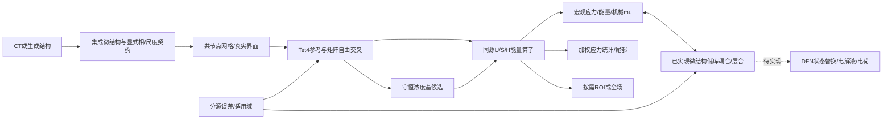

# 体系结构与接口契约

当前是可演进研究架构，不预先指定最终压缩算法。已有源码在src内实际集成；新增线性模块具备独立验证，完整系统门禁仍未通过。详细边界/失败记录见 [LINEAR_CORE](LINEAR_CORE.md)。

```text
MORQEX/
  src/morqex/
    geometry.py             # 已实现：显式相语义/SI/不可变标签/几何指纹
    workspace.py            # 已实现：外部路径约束
    gemsim.py               # 已实现：内部微结构与统一数据契约转换
    mechanics/              # Mandel、Tet4、KUBC/PBC/Neumann、LU/元素CG
    transport.py            # 真实活性域守恒FV、显式表面/颗粒ID
    concentration.py        # 几何/谱/POD/联合度量、每分量质量模式
    energy.py               # H/h/w0、U/S、模式mu、机械残差Gram与缓存
    statistics.py           # 精确矩、主应力/P99/CVaR离散包络
    coupling.py             # 二次化学能微结构双向/储库反应、checkpoint
    adaptivity.py           # 机械Galerkin富集；能量修正外显
    certification.py        # 固定Fick浓度后验界/目标传递/事务式拒绝
    tail.py                 # 全离散覆盖的P99区间细分与预算状态
    macroscale.py           # 一维多层压力/厚度约束
    microstructure/         # 已集成：原GEMsim全部src/gem源码
      core/                 # 颗粒图、体素场、分布、光栅/Cython/EDT
      generate/             # v0、条件扩散、混合/空间/重构/选择
      mesh/                 # 共节点体素Hex/Tet、曲面、TetGen、ACVD
      simulate/             # NGSolve输运/扩散/均匀化、PyBaMM、echemAMR源码
      resources/            # 小文本物理输入模板
      volume.py, image.py, analysis.py, pipeline.py, reporting.py ...
  configs/                  # 默认单CPU资源与研究种子
  literature/               # 参考与能力元数据
  provenance/               # 上游提交、逐文件迁移hash与原构建说明
  benchmarks/, tests/, scripts/, docs/
```



## 已实现的几何入口

```python
from pathlib import Path
from morqex import Workspace
from morqex.gemsim import GEMsim
from morqex.microstructure import Volume

ws = Workspace(Path('/home/zephyrain/lw/morph_workspace'))
provider = GEMsim(ws)  # 仅导入当前src，无Git/外部checkout依赖
data = provider.random_field(
    shape=(8, 8, 8), fractions=(.3, .6, .1), length_scale=(1.,1.,1.),
    spacing=(1e-6,)*3, seed=7,
    phase_kinds={0:'pore', 1:'active', 2:'cbd'},
)
mesh = provider.mesh(data, cell_type='tetra')
provider.to_volume(data).save(ws.path('outputs', 'example.npz'))
```

`MicrostructureData`为面向物理的契约，`morqex.microstructure.Microstructure`为原GEMsim流式facade，两者含义不同。标签ZYX、spacing/origin也ZYX；点坐标XYZ。相标签、颗粒ID和晶粒ID不得混为一个字段。当前后两项未由契约自动推断；未来以独立可选数组及出处加入。

## 输入/输出契约（完整目标；具体已实现子集见LINEAR_CORE）

| 模块 | 输入 | 输出及不变量 |
|---|---|---|
| 材料 | 相/晶粒取向、c/T、出处/单位、参考态 | Mandel C、eps_ch及导数；SPD/对称；未经校准标记 |
| 参考力学 | 网格、材料、BC、宏观应变/压力、本征场 | 位移/应变/应力/反力/能量/真实残差/收敛状态 |
| 浓度状态 | 真实扩散域/界面、质量M、反应摩尔通量、初态 | a、库存、可行性、界面trace；不重复DFN锂状态 |
| 能量响应 | 相同离散约束、材料/模式/参考态 | H/h/w0、U/S、解析梯度/切线、适用域与hash |
| 均匀化A | q、能量算子、宏观BC | 应力/能量/模式mu；成本不遍历微网格 |
| 统计B | q、分相矩/采样、体积权重、风险定义 | 均值/协方差/尾部+误差标签；非线性风险不伪装二次型 |
| 局部化C | q、区域/相/颗粒选择、U/S分块 | 实际请求区域的场；不默认每时步输出全部 |
| 误差/适应 | 分源残差、目标、适用域、资源预算 | 保持状态/质量的富集或回退，含滞回与失败原因 |
| 电化学耦合 | DFN非固扩散状态、替换后的a、机械mu/trace | 同一反应源与电荷、能量功率；OCV机械项只计一次 |
| 宏观力学 | 各位置算子、几何/层合、载荷 | 电极/电芯应变应力、外功、代表性误差 |

算子manifest至少记录schema、几何/材料/基/BC/求积hash、代码提交、单位、张量顺序、参考态、有效范围、精度、离线残差及源数据。禁止仅以文件名作为缓存身份。路径/状态恢复失败必须显式报错。

当前算子保存数据校验及内容/实现指纹，实验manifest配合Git提交；它不是有材料出处数据库的完整工业算子注册表。`bind_chemical_modes`用母体素ID检查FV库存与Tet活性体积一致，不能只按数组长度连接不同几何。

## 新物理核心的最小入口

```python
import numpy as np
from morqex.mechanics import TetMesh, ElasticitySolver, isotropic_stiffness
from morqex.transport import VoxelDiffusion
from morqex.concentration import ConcentrationBasis, ReducedDiffusion
from morqex.coupling import bind_chemical_modes, CoupledTransport
from morqex.energy import ResponseBuilder

volume = provider.to_volume(data)
diffusion = VoxelDiffusion(volume, active_phases=[1], diffusivity=1e-14,
                           reactive_phases=[0])
basis = ConcentrationBasis.spectral(diffusion, diffusion.n_components + 4)
mesh = TetMesh.from_volume(volume, solid_phases=[1, 2])
# Synthetic illustration only: replace with sourced phase/texture tensors.
solver = ElasticitySolver(mesh, isotropic_stiffness(1e9, .25), boundary='kubc')
beta = np.array([1e-6, 1e-6, 1e-6, 0., 0., 0.])
builder = ResponseBuilder(solver, bind_chemical_modes(solver, diffusion, basis, beta))
response = builder.exact()
model = CoupledTransport(response, ReducedDiffusion(diffusion, basis),
    chemical_curvature=.1, reference_concentration=20000., maximum_concentration=40000.)
state = model.initialize(np.zeros(basis.values.shape[1]))
state, diagnostics = model.step(state, .5)
q = np.r_[state.macro_strain, state.coefficients]
mean_stress = response.macro_stress(q)        # Level A, no micro traversal
first_tet_stress = response.stress(q, [0])    # Level C, requested ROI only
```

谱空间维数不得小于扩散分量数且不得超过活性体素数。将反应表面trace用于储库步进时，在线成本随实际表面代表数增长；默认不恢复体场不代表所有在线成本均与N无关。完整示例/同阶对照使用 `benchmarks/run_linear_study.py`，所有输出仅在外部工作区。

## 0.0.3认证入口和报告

`ConcentrationBasis.boundary_resolvent(diffusion, m, patterns)`支持声明通量空间方向的响应基。`CertifiedControlledDiffusion`在同一M/K、基与通量库上初始化浓度偏差，返回只读、模型绑定的状态；`step(..., error_tolerance=...)`超误差或物理包络时抛出错误，旧状态保持不变。调用方需要显式富集/重新离线构造/高保真回退；接口不会无依据重置累计误差，也没有自动转移双向历史。

该证书仅固定Fick，不可直接接到上例`CoupledTransport`冒充认证。`QuantileTree.query`的`converged`只代表P99区间宽度，必须另看预算/耗时及浓度误差。当前小网格树慢于向量化全统计。详细推导与域内/新热点对照见 [CERTIFIED_TRANSPORT](CERTIFIED_TRANSPORT.md)。

`scripts/build_test_report.py`消费外部受控试验、原协议、球参考和JUnit，生成外部单文件HTML；`scripts/check_test_report.py`校验DOM/数据/PNG及QuickJS筛选/导出。当前不含全浏览器渲染检查。内嵌原始数据可下载，关闭JS仍可读正文。

## 构建与可选依赖

纯Python基础wheel已支持；微结构图像/网格依赖在`geometry` extra，AI与仿真在独立extra。默认安装不编译Cython或AMReX，不触发训练/下载数据。`setup.py`通过显式 `MORQEX_BUILD_GEOMETRY=1` 启用六个Cython扩展；需先在外部构建环境安装Cython>=3.1、NumPy和C++编译器，再用`--no-build-isolation`构建。生成C++、对象、metadata、wheel均外置。此可选全原生构建尚未数值认证。

echemAMR保留独立原生构建入口和原模型/许可证；默认CPU。安装它不代表参考方程与容限已通过MORQEX资格门禁。未来若后端成为默认，须为原始量输出、收敛和物理导数增加统一适配并单独验证。
